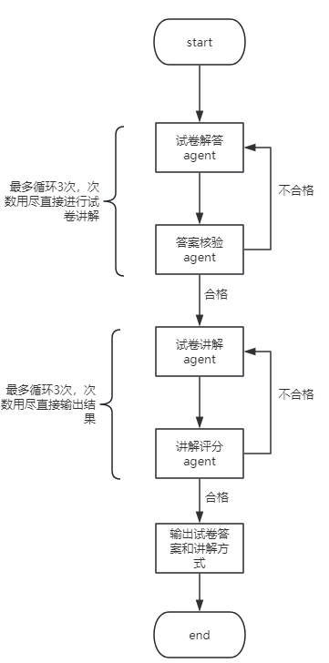

1 基于langgraph构建工作流

2 整个图存在4个智能体，分别为：
试卷解答agent、答案核验agent、试卷讲解agent、讲解评分agent

3 整体的agent流如下图所示：

4 针对以上所有的agent，进行如下要求：

试卷解答agent需要解答出上传试卷的每个题目，得出题目答案，尽可能保证答案的准确性
，同时要按照题目的种类给出答案，比如选择题就给出选项、填空题就给出填空结果、问答题
给出完整且符合得分要求的解体步骤。

答案核验agent需要对试卷解答agent给出的答案进行验证，包括反例、边界、解答完整性等，
如果某个题目的答案不符合要求，需要给出修改意见并让试卷解答agent重新对这个题目进行解答，
最多循环三次。

试卷讲解agent需要作为一个专业性极强的专业科目老师，给出正式课堂上的讲解方式。
要求能引导学生们读懂题目，找到正确的解题思路，串联起相关的不同知识点，用具体、
生动、通俗易懂的话语讲解题目。并给出用户（老师）具体的讲解步骤

讲解评分agent需要对试卷讲解agent的结果进行评分，从专业性、全面性、通俗易懂性和
逻辑性等方面评价，给出分数和不足的理由，并让试卷讲解agent重新构建讲解流程，
最多循环三次。

5 本多智能体的数据结构建议使用Pydantic，同时预留之后开发需要的知识库和数据库存储
接口，此次先略过数据存储。

